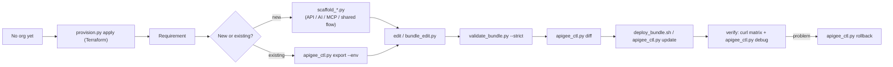

# Apigee Skills

Standalone agent skills for **building new and updating existing Apigee X proxies** across the three gateway
use cases:

| Use case | Skill | What you get |
|---|---|---|
| **Provision Apigee X** (Terraform) | [`apigee-x-provisioning`](skills/apigee-x-provisioning/SKILL.md) | Terraform module + `provision.py`: non-peered paid org, **PAYG INTERMEDIATE env + Analytics** by default, CMEK, PSC + HTTPS LB, sample proxy |
| Any proxy task (start here) | [`apigee-proxy-builder`](skills/apigee-proxy-builder/SKILL.md) | 24 policy/flow references (incl. official best-practices and security-architecture checklists), `validate_bundle.py`, `deploy_bundle.sh` |
| **API** Management (REST) | [`apigee-api-proxy`](skills/apigee-api-proxy/SKILL.md) | `scaffold_api_proxy.py` (API key / OAuth / JWT, OAS validation, quota, cache, CORS, JSON/XML threat protection, backend mTLS), `scaffold_shared_flow.py` |
| **AI** Gateway (LLM) | [`apigee-ai-gateway`](skills/apigee-ai-gateway/SKILL.md) | `scaffold_ai_gateway.py` (Gemini + Claude, `/auto` routing, Model Armor, token quota, semantic cache) |
| **MCP** Tools Gateway | [`apigee-mcp-gateway`](skills/apigee-mcp-gateway/SKILL.md) | `scaffold_mcp_proxy.py` (per-tool products, argument limits, keyless handshake) |
| Update existing proxies | [`apigee-proxy-lifecycle`](skills/apigee-proxy-lifecycle/SKILL.md) | `apigee_ctl.py` (export, diff, update, rollback, products, developers, apps & keys, KVMs, target servers, flow hooks, trace masks, trace), `bundle_edit.py` |

Everything is **stdlib Python 3.9+ / bash**: no repo, framework, `apigeecli` or Maven plugin required. Auth uses
`gcloud auth print-access-token` (or `$APIGEE_TOKEN`).



## Install & Import Guide

Clone this repository once, then install into your preferred AI coding agent(s):

```bash
git clone git@github.com:maloosatyam-google/apigee-skills.git
cd apigee-skills
```

| Agent / IDE | User / Global Install | Project / Workspace Install | Loaded Artifacts |
|---|---|---|---|
| **Google Antigravity** (App, IDE, `agy` CLI) | `./install.sh` or `agy plugin install .` | `./install.sh --project /path/to/workspace` | 6 skills, 2 path-scoped rules, 2 subagents |
| **Claude Code** | `./install.sh --claude ~` | `./install.sh --claude /path/to/repo` or `claude --plugin-dir .` | 6 skills, 2 path-scoped rules, 2 subagents |
| **GitHub Copilot** (VS Code, CLI, Cloud Agent) | `./install.sh --copilot ~` | `./install.sh --copilot /path/to/repo` | 6 skills, 2 `.instructions.md` rules, 2 `.agent.md` agents |
| **Gemini CLI** | `./install.sh --gemini ~` or `gemini extensions install .` | `./install.sh --gemini /path/to/repo` | 6 skills, 2 rules, 2 agents |
| **OpenAI Codex / Cursor / Windsurf** | `./install.sh --codex ~` | `./install.sh --codex /path/to/repo` | 6 skills (`.agents/skills/`) |
| **Any custom path** | — | `./install.sh --target /path/to/skills` | 6 skills |

Pass `--force` to overwrite an existing installation, or `--copy` with `./install.sh` to copy instead of symlinking the global Antigravity plugin. You can also run any script in `skills/*/scripts/` directly without an agent.

---

### 1. Google Antigravity (App, IDE & `agy` CLI)

Antigravity supports loading this repository either as a **unified plugin** (recommended) or as **workspace-scoped `.agents/` customizations**.

#### Option A: Global Plugin (Recommended)
```bash
# Symlinks the plugin into ~/.gemini/config/plugins/apigee-skills
./install.sh

# Or install via the Antigravity CLI from a local checkout or Git URL:
agy plugin install /path/to/apigee-skills
# agy plugin install https://github.com/maloosatyam-google/apigee-skills

# Verify plugin contents and status:
agy plugin validate /path/to/apigee-skills
agy plugin list
```
 In the Antigravity App or IDE, open **Customizations → Plugins** (or run `/plugin` in chat) to view or toggle **Apigee X Skills**.

#### Option B: Workspace-Scoped Install (`.agents/`)
Install directly into a project workspace so only that project loads the Apigee skills, rules, and subagents (and can optionally commit them to source control):
```bash
./install.sh --project /path/to/your-project
# Populates /path/to/your-project/.agents/{skills,rules,agents}
```

#### Option C: Link Without Copying (`.agents/skills.json`)
To reference this checkout from a workspace without copying files, create `<workspace>/.agents/skills.json`:
```json
{
  "entries": [
    { "path": "/absolute/path/to/apigee-skills/skills", "enabled": true }
  ]
}
```

---

### 2. Claude Code

Claude Code discovers `SKILL.md` skills, `.claude/rules/*.md` path-scoped rules, and `.claude/agents/*.md` subagents, or can load this repo directly as a plugin via `.claude-plugin/plugin.json`.

#### Option A: Personal Scope (Available Across All Projects)
```bash
./install.sh --claude ~
# Installs ~/.claude/skills/*, ~/.claude/rules/*.md, and ~/.claude/agents/*.md
```

#### Option B: Project Scope (Shared with Your Team)
```bash
./install.sh --claude /path/to/your-project
# Installs <project>/.claude/skills/*, <project>/.claude/rules/*.md, and <project>/.claude/agents/*.md
```

#### Option C: Load Directly as a Claude Code Plugin
```bash
claude --plugin-dir /path/to/apigee-skills
```

#### Usage in Claude Code
- **Automatic**: Claude automatically activates the matching skill when you ask an Apigee question and enforces `.claude/rules/*.md` whenever you edit `**/apiproxy/**`, `**/sharedflowbundle/**`, or `**/api_product*.json`.
- **Slash commands**: Invoke any skill directly with `/apigee-api-proxy`, `/apigee-ai-gateway`, `/apigee-mcp-gateway`, `/apigee-proxy-lifecycle`, `/apigee-proxy-builder`, or `/apigee-x-provisioning`.
- **Subagents**: Delegate design or end-to-end verification to the `apigee-architect` or `apigee-gateway-tester` subagents (view with `/agents`).

---

### 3. GitHub Copilot (VS Code, Copilot CLI & Coding Agent)

GitHub Copilot supports Agent Skills (`.github/skills/` and `~/.copilot/skills/`), path-scoped custom instructions (`.github/instructions/*.instructions.md`), and custom agents (`.github/agents/*.agent.md`).

#### Option A: Repository Install (Skills + Instructions + Custom Agents)
```bash
./install.sh --copilot /path/to/your-project
```
This installs:
- `.github/skills/<skill-name>/SKILL.md` (all 6 skills + scripts + references)
- `.github/instructions/apigee_proxy_standards.instructions.md` and `security_and_governance.instructions.md` (auto-applied via `applyTo` globs when editing proxy bundles or products)
- `.github/agents/apigee-architect.agent.md` and `apigee-gateway-tester.agent.md` (selectable in the VS Code Chat agent picker)

#### Option B: Personal Install (User Profile)
```bash
./install.sh --copilot ~
# Installs ~/.copilot/skills/* and ~/.copilot/agents/*.agent.md
```

#### Option C: Cross-Agent Discovery or VS Code Plugin
- VS Code Copilot also automatically discovers skills installed in `<workspace>/.agents/skills/` (`./install.sh --project`) or `<workspace>/.claude/skills/` (`./install.sh --claude`).
- You can also install the repository as an Agent Plugin in VS Code via the Command Palette: **Chat: Install Plugin From Source** → select the `apigee-skills` folder.
- Type `/skills` in VS Code Copilot Chat to inspect loaded skills, or invoke `/apigee-api-proxy`, `/apigee-ai-gateway`, etc. directly.

---

### 4. Gemini CLI

```bash
# Install as a Gemini CLI extension (uses gemini-extension.json):
gemini extensions install /path/to/apigee-skills

# Or install into ~/.gemini/{skills,rules,agents} (user scope) or <repo>/.gemini/{skills,rules,agents} (project scope):
./install.sh --gemini ~
./install.sh --gemini /path/to/your-project
```

---

### 5. OpenAI Codex, Cursor & Other `SKILL.md`-Compatible Agents

For agents that follow the open `.agents/skills/<name>/SKILL.md` standard (OpenAI Codex, Cursor, Windsurf, etc.):

```bash
# Project-scoped (.agents/skills/<skill-name>/SKILL.md):
./install.sh --codex /path/to/your-project

# User-scoped (~/.agents/skills/<skill-name>/SKILL.md):
./install.sh --codex ~

# Or copy skills directly into any custom directory:
./install.sh --target /path/to/custom/skills
```

## Five-minute tour

```bash
# 0. No Apigee org yet? Provision one (PAYG, INTERMEDIATE env 'dev', Analytics on, PSC + HTTPS LB)
python3 skills/apigee-x-provisioning/scripts/provision.py plan  --project my-proj --region us-central1
python3 skills/apigee-x-provisioning/scripts/provision.py apply --project my-proj --region us-central1 --sample
source apigee-x-infra/apigee-x.env

export APIGEE_ORG=my-org APIGEE_ENV=dev APIGEE_DEPLOY_SA=apigee-runtime@my-proj.iam.gserviceaccount.com
S=skills

# API proxy from an OpenAPI spec
python3 $S/apigee-api-proxy/scripts/scaffold_api_proxy.py --out ./orders-v1 --name orders-v1 \
  --basepath /orders/v1 --target https://mocktarget.apigee.net --auth apikey --quota \
  --oas examples/specs/orders-v1.json --health
python3 $S/apigee-proxy-lifecycle/scripts/apigee_ctl.py update ./orders-v1        # validate+import+deploy+wait
python3 $S/apigee-proxy-lifecycle/scripts/apigee_ctl.py product-apply ./orders-v1/api_product.json --env $APIGEE_ENV
python3 $S/apigee-proxy-lifecycle/scripts/apigee_ctl.py app-create me@example.com orders-tester --product orders-v1-standard --create-developer

# AI gateway (Gemini + Claude + auto routing + token quota)
python3 $S/apigee-ai-gateway/scripts/scaffold_ai_gateway.py --out ./ai-gateway-v1 --project my-proj \
  --token-quota --claude --auto-route

# MCP gateway with personas and a refund limit
python3 $S/apigee-mcp-gateway/scripts/scaffold_mcp_proxy.py --out ./orders-mcp --name orders-mcp \
  --basepath /orders/mcp --target https://orders-mcp-xyz.a.run.app/mcp --tools searchOrders,issueRefund \
  --persona "Support:searchOrders,issueRefund" --persona "Insights:searchOrders" \
  --limit 'issueRefund:amount:50:Support:REFUND_LIMIT:Refunds over $50 need approval.'

# Update an existing deployed proxy
C="python3 $S/apigee-proxy-lifecycle/scripts/apigee_ctl.py"
$C export orders-v1 --env dev --out ./work/orders-v1
python3 $S/apigee-proxy-lifecycle/scripts/bundle_edit.py set-target-url ./work/orders-v1 https://orders-v2.example.com
$C diff ./work/orders-v1 --env dev && $C update ./work/orders-v1 --env dev
$C rollback orders-v1 --env dev      # if needed
```

Example prompts for an agent with these skills installed:
- "Create an Apigee proxy for https://orders-xyz.a.run.app using ./openapi.yaml, protected by API keys, 100 req/min."
- "Put an AI gateway in front of Gemini and Claude with per-user token quotas and Model Armor."
- "Expose our inventory MCP server through Apigee; only the Ops persona may call adjustStock above 100 units."
- "Provision Apigee X in project my-proj (us-central1) with a PAYG Intermediate environment and Analytics."
- "Add a spike arrest of 10 per second to the deployed `payments-v1` proxy in test, show me the diff first."

## Repository layout

```text
plugin.json                  Antigravity / Copilot plugin manifest
.claude-plugin/plugin.json   Claude Code plugin manifest (claude --plugin-dir .)
gemini-extension.json        Gemini CLI extension manifest (gemini extensions install .)
install.sh                   multi-agent installer (Antigravity, Claude Code, Copilot, Gemini CLI, Codex/Cursor)
cloudbuild.release-notes.yaml Cloud Build pipeline to sync Apigee release notes into the skills
scripts/
  sync_release_notes.py      checks Apigee release notes Atom feed & applies/verifies updates via Vertex AI Gemini
  setup_cloud_scheduler.sh   provisions the weekly Google Cloud Scheduler job (`0 9 * * 1`)
  release_notes_state.json   tracks the last synced Apigee X release date & version
skills/
  apigee-proxy-builder/      core: SKILL.md, references/ (24 docs), scripts/validate_bundle.py, deploy_bundle.sh
  apigee-api-proxy/          scaffold_api_proxy.py, scaffold_shared_flow.py, references/api_proxy_patterns.md
  apigee-ai-gateway/         scaffold_ai_gateway.py, references/model_routing_playbook.md
  apigee-mcp-gateway/        scaffold_mcp_proxy.py, references/mcp_rest_bridge.md
  apigee-proxy-lifecycle/    apigee_ctl.py, bundle_edit.py, references/update_playbook.md
  apigee-x-provisioning/     terraform/ (module + mocked-provider tests), scripts/provision.py
rules/                       apigee_proxy_standards.md, security_and_governance.md (auto-applied to bundle files)
agents/                      apigee-architect.md, apigee-gateway-tester.md (subagent personas)
examples/specs/              sample OpenAPI spec
tests/                       offline test suite + mock Apigee management API
```

## Keeping Skills Synced with Apigee Release Notes (Google Cloud Scheduler)

To automatically monitor [Apigee release notes](https://docs.cloud.google.com/apigee/docs/release-notes) and update these skills when new Apigee X policies or features ship:

```bash
# 1. Check locally for any new Apigee X release notes since scripts/release_notes_state.json:
python3 scripts/sync_release_notes.py --check

# 2. Preview or provision the weekly Monday 9:00 AM Google Cloud Scheduler + Cloud Build job:
./scripts/setup_cloud_scheduler.sh --project my-gcp-project --region us-central1 --dry-run
./scripts/setup_cloud_scheduler.sh --project my-gcp-project --region us-central1
```

## Development

```bash
make test       # 34 offline tests (Terraform module tests run when terraform is installed): scaffolds, validator bug detection, bundle edits, lifecycle vs mock API, JS converters, multi-agent installer, release-notes sync
make examples   # generate + strictly validate one bundle of each kind into ./build
make lint
```
Rules for contributors: keep scripts stdlib-only, keep every generated bundle passing `validate_bundle.py --strict`,
and add a test for every new scaffold option or validator check. Use `cloud.google.com/apigee` docs (Apigee X),
not legacy `docs.apigee.com` (Edge).

## Requirements for live use
- Provisioning: Terraform >= 1.5, `gcloud auth application-default login`, a billing-linked project (see the provisioning skill)
- Apigee X / hybrid org, `gcloud` authenticated as a user or SA with `roles/apigee.apiAdminV2` +
  `roles/apigee.environmentAdmin` (and `iam.serviceAccounts.actAs` on the runtime SA)
- Runtime SA roles as needed: `roles/run.invoker` (Cloud Run targets), `roles/aiplatform.user` (Vertex AI),
  `roles/modelarmor.user`, `roles/logging.logWriter`
