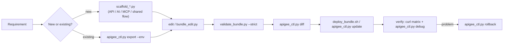

# Apigee Skills

Standalone agent skills for **building new and updating existing Apigee X proxies** across the three gateway
use cases:

| Use case | Skill | What you get |
|---|---|---|
| Any proxy task (start here) | [`apigee-proxy-builder`](skills/apigee-proxy-builder/SKILL.md) | 24 policy/flow references (incl. official best-practices and security-architecture checklists), `validate_bundle.py`, `deploy_bundle.sh` |
| **API** Management (REST) | [`apigee-api-proxy`](skills/apigee-api-proxy/SKILL.md) | `scaffold_api_proxy.py` (API key / OAuth / JWT, OAS validation, quota, cache, CORS, JSON/XML threat protection, backend mTLS), `scaffold_shared_flow.py` |
| **AI** Gateway (LLM) | [`apigee-ai-gateway`](skills/apigee-ai-gateway/SKILL.md) | `scaffold_ai_gateway.py` (Gemini + Claude, `/auto` routing, Model Armor, token quota, semantic cache) |
| **MCP** Tools Gateway | [`apigee-mcp-gateway`](skills/apigee-mcp-gateway/SKILL.md) | `scaffold_mcp_proxy.py` (per-tool products, argument limits, keyless handshake) |
| Update existing proxies | [`apigee-proxy-lifecycle`](skills/apigee-proxy-lifecycle/SKILL.md) | `apigee_ctl.py` (export, diff, update, rollback, products, KVM, target servers, flow hooks, trace), `bundle_edit.py` |

Everything is **stdlib Python 3.9+ / bash**: no repo, framework, `apigeecli` or Maven plugin required. Auth uses
`gcloud auth print-access-token` (or `$APIGEE_TOKEN`).



## Install

```bash
git clone <this-repo> apigee-skills && cd apigee-skills
./install.sh                         # Antigravity / Gemini: global plugin (~/.gemini/config/plugins/apigee-skills)
./install.sh --project ~/code/my-api # project-scoped .gemini/{skills,rules,agents}
./install.sh --claude ~              # Claude Code user skills (~/.claude/skills)
./install.sh --target ./.agents/skills   # any agent that reads a skills folder
```
Or use the scripts directly; every skill folder is self-describing (`SKILL.md` + `scripts/` + `references/`).

## Five-minute tour

```bash
export APIGEE_ORG=my-org APIGEE_ENV=dev APIGEE_DEPLOY_SA=apigee-runtime@my-proj.iam.gserviceaccount.com
S=skills

# API proxy from an OpenAPI spec
python3 $S/apigee-api-proxy/scripts/scaffold_api_proxy.py --out ./orders-v1 --name orders-v1 \
  --basepath /orders/v1 --target https://mocktarget.apigee.net --auth apikey --quota \
  --oas examples/specs/orders-v1.json --health
python3 $S/apigee-proxy-lifecycle/scripts/apigee_ctl.py update ./orders-v1        # validate+import+deploy+wait
python3 $S/apigee-proxy-lifecycle/scripts/apigee_ctl.py product-apply ./orders-v1/api_product.json --env $APIGEE_ENV

# AI gateway (Gemini + Claude + auto routing + token quota)
python3 $S/apigee-ai-gateway/scripts/scaffold_ai_gateway.py --out ./ai-gateway-v1 --project my-proj \
  --token-quota --claude --auto-route

# MCP gateway with personas and a refund limit
python3 $S/apigee-mcp-gateway/scripts/scaffold_mcp_proxy.py --out ./orders-mcp --name orders-mcp \
  --basepath /orders/mcp --target https://orders-mcp-xyz.a.run.app/mcp --tools searchOrders,issueRefund \
  --persona "Support:searchOrders,issueRefund" --persona "Insights:searchOrders" \
  --limit 'issueRefund:amount:50:Support:REFUND_LIMIT:Refunds over $50 need approval.'

# Update an existing deployed proxy
C="python3 $S/apigee-proxy-lifecycle/scripts/apigee_ctl.py"
$C export orders-v1 --env dev --out ./work/orders-v1
python3 $S/apigee-proxy-lifecycle/scripts/bundle_edit.py set-target-url ./work/orders-v1 https://orders-v2.example.com
$C diff ./work/orders-v1 --env dev && $C update ./work/orders-v1 --env dev
$C rollback orders-v1 --env dev      # if needed
```

Example prompts for an agent with these skills installed:
- "Create an Apigee proxy for https://orders-xyz.a.run.app using ./openapi.yaml, protected by API keys, 100 req/min."
- "Put an AI gateway in front of Gemini and Claude with per-user token quotas and Model Armor."
- "Expose our inventory MCP server through Apigee; only the Ops persona may call adjustStock above 100 units."
- "Add a spike arrest of 10 per second to the deployed `payments-v1` proxy in test, show me the diff first."

## Repository layout

```text
plugin.json                  plugin manifest (drop the repo into a plugins/ folder)
skills/
  apigee-proxy-builder/      core: SKILL.md, references/ (24 docs), scripts/validate_bundle.py, deploy_bundle.sh
  apigee-api-proxy/          scaffold_api_proxy.py, scaffold_shared_flow.py, references/api_proxy_patterns.md
  apigee-ai-gateway/         scaffold_ai_gateway.py, references/model_routing_playbook.md
  apigee-mcp-gateway/        scaffold_mcp_proxy.py, references/mcp_rest_bridge.md
  apigee-proxy-lifecycle/    apigee_ctl.py, bundle_edit.py, references/update_playbook.md
rules/                       apigee_proxy_standards.md, security_and_governance.md (auto-applied to bundle files)
agents/                      apigee-architect.md, apigee-gateway-tester.md (subagent personas)
examples/specs/              sample OpenAPI spec
tests/                       offline test suite + mock Apigee management API
```

## Development

```bash
make test       # 24 offline tests: scaffolds, validator bug detection, bundle edits, lifecycle vs mock API, JS converters
make examples   # generate + strictly validate one bundle of each kind into ./build
make lint
```
Rules for contributors: keep scripts stdlib-only, keep every generated bundle passing `validate_bundle.py --strict`,
and add a test for every new scaffold option or validator check. Use `cloud.google.com/apigee` docs (Apigee X),
not legacy `docs.apigee.com` (Edge).

## Requirements for live use
- Apigee X / hybrid org, `gcloud` authenticated as a user or SA with `roles/apigee.apiAdminV2` +
  `roles/apigee.environmentAdmin` (and `iam.serviceAccounts.actAs` on the runtime SA)
- Runtime SA roles as needed: `roles/run.invoker` (Cloud Run targets), `roles/aiplatform.user` (Vertex AI),
  `roles/modelarmor.user`, `roles/logging.logWriter`
